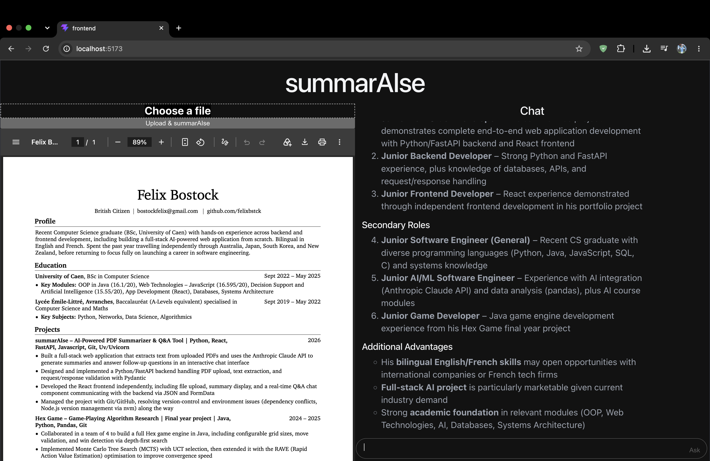

# summarAIse

Upload a PDF, get an AI-generated summary, then ask follow-up questions about it in a chat interface.

<p align="center">
  
</p>

## Features

- Drag and drop (or browse for) a PDF, with a live preview beside the chat
- Automatic summary of the document, powered by Claude
- Ask questions about the uploaded document, with Markdown rendered answers
- Chat history survives a page refresh (stored in the browser)

## Tech stack

| Layer    | Tools                                                        |
| -------- | ------------------------------------------------------------ |
| Frontend | React (Vite), CSS, react-markdown                      |
| Backend  | Python, FastAPI, Uvicorn, Pydantic, pypdf                    |
| AI       | Anthropic API (Claude Haiku 4.5)                             |

## How it works

The frontend and backend are separate apps that talk over HTTP and JSON. The backend extracts the PDF's text in memory, keeps it under a document ID, and sends it to Claude along with each question.

## Running it locally

You'll need Python 3.10+, Node 20.19+ (or 22.12+), and an [Anthropic API key](https://platform.claude.com/).

### Backend

```bash
cd backend
python3 -m venv venv
source venv/bin/activate          # Windows: venv\Scripts\activate
pip install -r ../requirements.txt
```

Create `backend/.env`:

```
ANTHROPIC_API_KEY=your-key-here
```

Start the server:

```bash
uvicorn main:app --reload
```

The API runs on `http://localhost:8000`, and interactive docs are at `/docs`.

### Frontend

In a second terminal:

```bash
cd frontend
npm install
npm run dev
```

Open `http://localhost:5173`.

## API

| Method | Endpoint  | Body                                | Returns                                |
| ------ | --------- | ----------------------------------- | -------------------------------------- |
| GET    | `/`       | none                                | health check                           |
| POST   | `/upload` | multipart form with a `file` (PDF)  | `doc_id`, `filename`, `num_pages`, `summary` |
| POST   | `/ask`    | JSON `{ "doc_id", "question" }`     | `answer`                               |


## What I learned

Building this end to end was my first full stack project after graduating: designing a small REST API, handling file uploads and CORS, integrating an LLM API, managing React state and effects, and debugging environment and tooling problems along the way.

## Project structure

```
summarAIse/
├── backend/
│   ├── main.py          # FastAPI app: /upload and /ask
│   └── .env             # API key (not committed)
└── frontend/
    └── src/
        ├── App.jsx      # upload, preview and chat UI
        └── App.css
```
